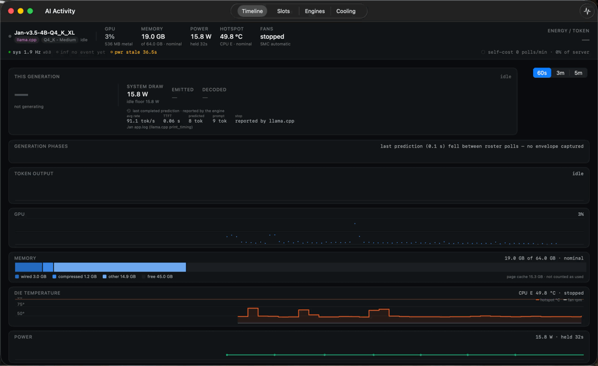
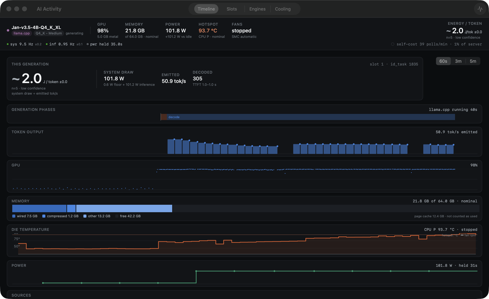
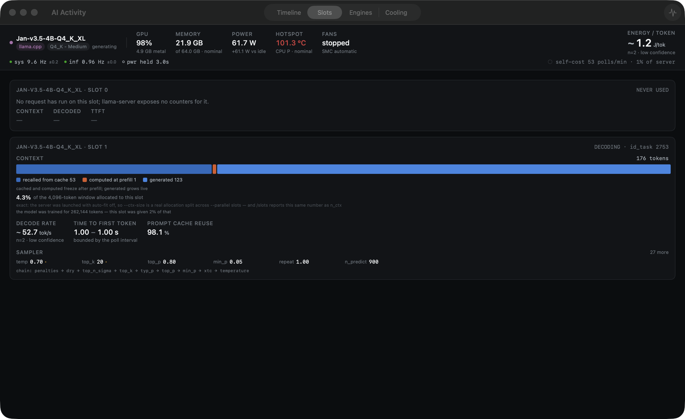
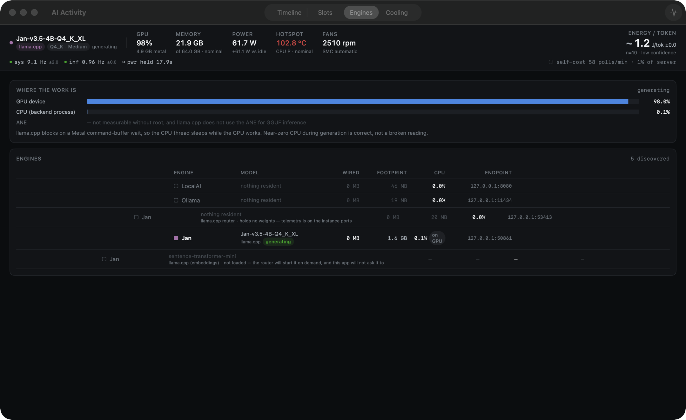
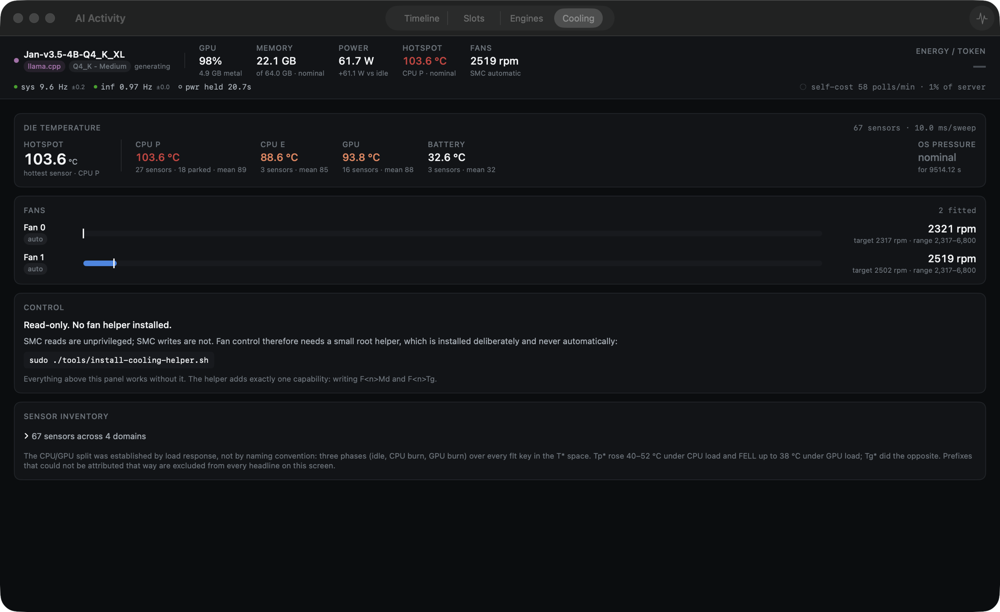
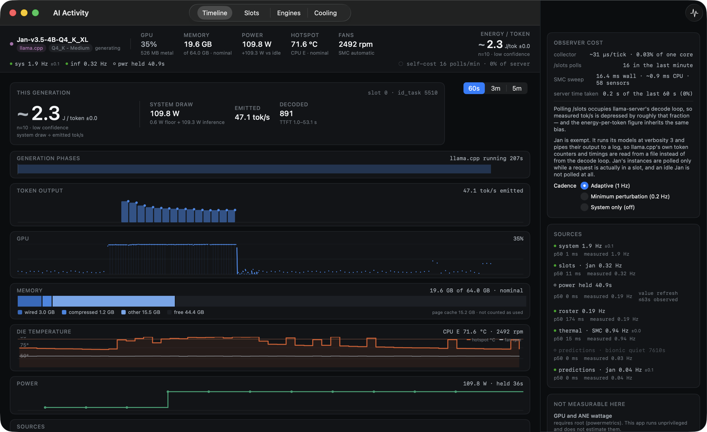

# AI Activity

A live instrument panel for local AI inference on macOS. It watches whatever
engine you already run — llama.cpp, MLX, Ollama, LocalAI — and answers the
question none of their UIs do: **what did that generation actually cost?**

Native SwiftUI, no dependencies, **observe-only**: it starts no generations,
loads no models, and never reads a prompt or a completion.

Headline metric: **joules per token** = system watts ÷ emitted tok/s, with the
idle floor subtracted, so what you see is the marginal energy cost of inference
rather than the cost of the machine being switched on.



*Twelve seconds, unedited: an idle panel, a request arriving, prefill, then decode.
Token bars fill, GPU goes to 97% while the backend process stays at 0.1% CPU,
system draw steps 15.8 → 100 W, and **joules per token settles at 1.7** as the
680-token generation finishes.*

> Status: works on my machine and is used daily, but it has run on exactly one
> Mac (M2 Max, macOS Tahoe). Sensor maps and engine quirks are measured, not
> guessed — see the [engineering notes](docs/ENGINEERING-NOTES.md) — but they
> were measured *here*. Reports from other hardware are very welcome.

## What it shows

| View | Answers |
|---|---|
| **Timeline** | What did that generation cost, and what happened when — token output, GPU, memory and power on one shared time axis |
| **Slots** | What is each of llama-server's slots doing, and with which sampler settings |
| **Engines** | Which runtime is actually burning resources (hue is earned by residency) |
| **Cooling** | How hot the die really is, what the fans are doing, and — with the root helper installed — what you want them to do instead |
| **Sources** (⌘I) | Per-source health, measured rates, the app's own observer cost, and what is *not* measurable |

### Timeline



One generation on one time axis: 50.9 tok/s emitted, 98% GPU, 101.8 W, 93.7 °C,
and 2.0 J/token. TTFT is shown as the interval `1.0–1.0 s` rather than a point,
because the app is not the client and can only bracket it by the poll interval.

### Slots



Slot 0 has never served a request, so every field is `—` rather than a stale
number. Slot 1 is decoding: 176 tokens of the **4,096-token window actually
allocated to it** — Jan is the one engine that pins that number down, so the app
states it instead of hedging between two denominators — with 98.1% of the prompt
recalled from cache, and the full sampler chain in force.

### Engines



98% GPU against 0.1% CPU, with the reason spelled out rather than reported as a
fault. Jan's three tiers are separate rows: the router holding no weights, the
instance actually generating, and a model the router *could* load on demand —
listed as holding nothing, because asking about it would have loaded it.

### Cooling



A 103.6 °C hotspot taken as the **maximum** over 67 sensors, not their mean, with
18 of the 27 P-core sensors excluded as power-gated — they were reading colder
than the room while the die was at 100 °C. Control is read-only until you
install the helper, and the panel says so.

### Sources (⌘I)



The app's own cost, measured and displayed: **31 µs per collector tick, 0.03% of
one core**, 16 `/slots` polls in the last minute, and 0.2 s of llama-server's
last 60 s spent answering them. Polling `/slots` steals decode time, so the
cadence is yours to set, and every source reports its own measured rate and
state.

## Requirements

- macOS 14 or later, Apple Silicon (the SMC sensor map and fan decoding are
  Apple-Silicon-specific; Intel Macs will run the app but Cooling will be thin)
- Swift 6 toolchain (Xcode 16+ or a Swift 6 command-line toolchain)
- At least one local inference engine, below. With none running, the app is
  honest about it rather than empty.

## Install

```sh
git clone https://github.com/foggylulu/mac-ai-activity.git
cd mac-ai-activity
./build.sh              # build + ad-hoc sign + install to ~/Applications
open -a "AI Activity"
```

`./build.sh /some/other/dir` installs elsewhere. The bundle is ad-hoc signed and
deliberately **not sandboxed** — it reads other processes via `libproc` and the
GPU via IOKit, both of which the sandbox blocks. Nothing it does needs root.

Fan *control* is the one exception, and it is opt-in:

```sh
sudo ./tools/install-cooling-helper.sh              # install + start the daemon
sudo ./tools/install-cooling-helper.sh --selftest   # exercise the write path only
sudo ./tools/install-cooling-helper.sh --uninstall
```

Everything else works read-only without it. **Fan writes are refused by the
kernel on my machine, so the helper ships unverified against real hardware** —
its guard logic is fully tested, but no successful fan write has ever been
observed. Treat it as experimental.

## Supported engines

| Engine | How it is watched |
|---|---|
| **[Jan](https://www.jan.ai/)** (llama.cpp, router mode) | Topology from the router, token rates from its log stream. Multi-instance, and the cheapest engine here to watch — an idle Jan is not polled at all. |
| **Bionic / LM Studio** (llama.cpp) | `/slots` polling, plus `lms ps` for what is resident. |
| **Bionic's embedded MLX** | `lms log stream` diagnostics — exact per-prediction receipts, no live rate (it binds no socket). |
| **mlx-lm** | HTTP endpoint. |
| **LocalAI**, **Ollama** | Discovery, roster and system-level attribution. |

Engines are found from the process table and listening sockets, not from config
files — every one of these assigns ports it does not write down anywhere.

## Command-line tools

```sh
swift run aienergy watch              # joules/token per generation, live
swift run aienergy status             # what is resident, is power readable at all
swift run telemetry-probe --live      # every collector, headless
swift run telemetry-probe --jan       # Jan topology + live receipts
swift run telemetry-probe --cost      # assert the collector CPU budget
swift run telemetry-probe --thermal   # SMC sweep, sensor inventory, budget
```

`aienergy` exists because LM Studio already reports tok/s and TTFT well; the one
thing it has no data for is energy, so the CLI does only that part. It shows,
for instance, the same model at the same wattage costing **2.5x more per token**
on a short generation than a long one, because time-to-first-token is amortised
over fewer tokens.

## Design rules

- **`Optional` means absent.** A measurement is a number; the absence of one is
  `—`. They are never confusable, in the types or on screen.
- **Domains are never fused.** System samples at ~10 Hz, `/slots` at ~1 Hz,
  power at ~0.25 Hz. Each carries its own timestamps; the UI aligns them on a
  shared axis and never interpolates the slow sources onto the fast grid.
- **Every derived number is an `Estimate`** carrying value, uncertainty, sample
  count and confidence. TTFT is published as a bounded interval, not a point,
  wherever the app is not the client.
- **Five source states, not two** — `absent` / `live` / `held` / `stale` /
  `dark`, rendered as visually incommensurable. A stopped server is *absent*,
  not failed; a value from a 4-second source is *held*, not stale.
- **The observer effect is first-class.** Polling `/slots` occupies llama.cpp's
  decode loop, so the app measures and displays its own cost, and offers a
  minimum-perturbation cadence.

Cost: the whole collector feed is **0.40% of one core** headless. The window
costs more than the sampling does, so the *display* rate is adaptive (1 Hz idle,
5 Hz generating) while sampling stays at full rate and no history is lost.

## What is not measurable

Stated up front, because a monitor that quietly guesses is worse than one that
says it does not know:

- **GPU/ANE wattage** — needs root (`powermetrics`). Whole-system watts is
  root-free and is what the app uses.
- **Live per-token rate on MLX** — the engine emits one stats object per
  prediction and nothing during decode. The retrospective average is exact; the
  instantaneous rate does not exist to be read.
- **Power while on AC** — battery amperage reflects charging current, not load.
  (An SMC key, `PSTR`, may be a way out of this; it is measured but deliberately
  not yet wired in.)
- **Speculative accept rate on llama.cpp** — `/slots` exposes configuration
  only, and `/metrics` answers 501 because neither Jan nor Bionic passes
  `--metrics`.
- **CPU throttle percentage** — does not exist on Apple Silicon. The OS
  thermal-pressure ladder is shown instead of a fabricated number.
- **Which client drove a generation**, and anything about a model that is not
  loaded beyond what the engine's catalogue states.

The full list, with what was measured to establish each one, is in the
[engineering notes](docs/ENGINEERING-NOTES.md).

## Privacy

No prompt or completion text ever enters a sample — `PredictionSample` has no
field that could hold one. Jan's per-launch API key is wrapped in an `APIKey`
type and is never rendered, logged, or copied into a sample. Nothing is
persisted to disk and nothing leaves the machine.

## See also

- [**llmctl**](https://github.com/foggylulu/llmctl) — the same machine's *memory*
  rather than its inference behaviour: which engines are holding RAM, which idle
  server processes are still pinning weights with `mlock`, and one command to get
  it back. This app answers "what did that generation cost"; that one answers
  "what is holding my RAM".
- [**wake-on-llm**](https://github.com/foggylulu/wake-on-llm) — powering a large
  local model on and off remotely over Tailscale, from a phone.

## Documentation

- [Engineering notes](docs/ENGINEERING-NOTES.md) — measurement traps, the SMC
  sensor map, the fan-control guard, benchmarks, and what is not measurable
- [`tools/bench/JAN_VS_BIONIC.md`](tools/bench/JAN_VS_BIONIC.md) — Jan's MLX
  engine vs Bionic's on identical weights
- [CONTRIBUTING.md](CONTRIBUTING.md)

## Tests

```sh
swift test    # 225 tests, no hardware or running engine required
```

Every trap described in the notes has a test. The fan-control guard in
particular is pure functions over values, so every release path is exercised
without overheating a laptop.

- [**solvr-ai**](https://github.com/foggylulu/solvr-ai) — a maths tutor app for
  iOS and macOS that runs against a hosted API, a local server, or Apple's
  on-device model, and measures the difference.

## License

**GPL-3.0** — see [LICENSE](LICENSE).

Use it, run it, fork it, sell it. The one condition: if you distribute a
derivative, ship its source under the same licence. The measurement work in
[docs/ENGINEERING-NOTES.md](docs/ENGINEERING-NOTES.md) is the substance of this
project, and it should stay readable by whoever ends up depending on it.

The first commits of this repo were published under MIT for a few hours on
2026-08-21. Anything obtained under that licence stays under it; everything from
`Relicense under GPL-3.0` onward is GPL-3.0.
